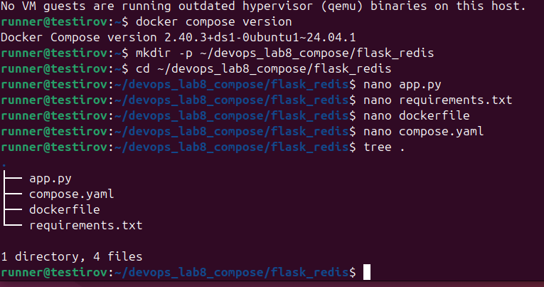
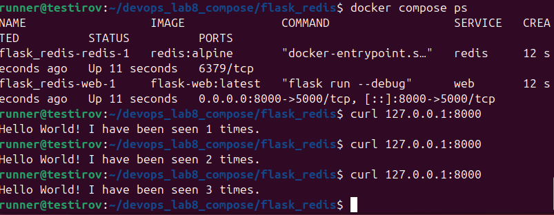
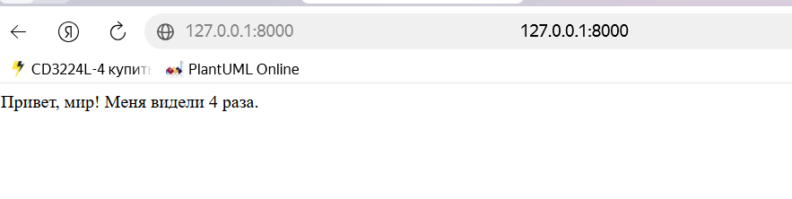
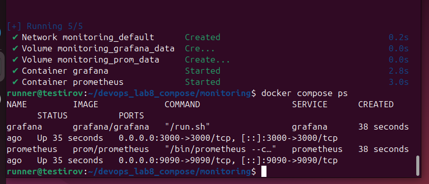
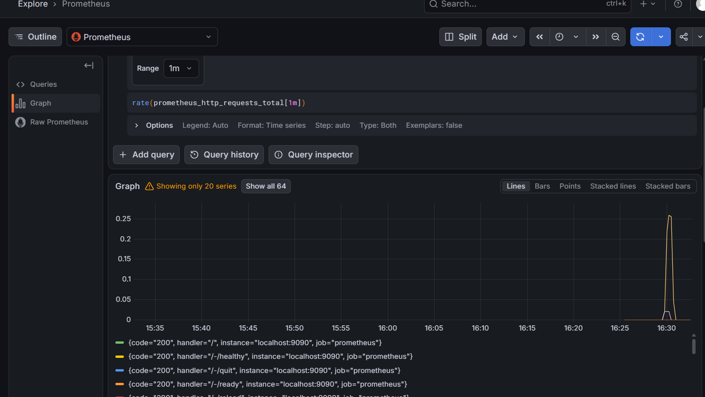
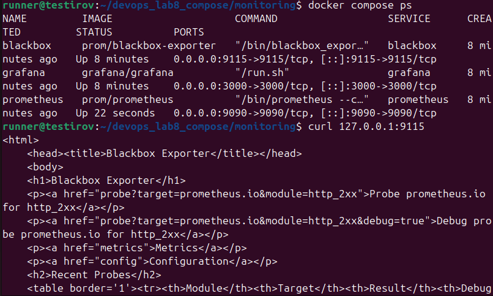
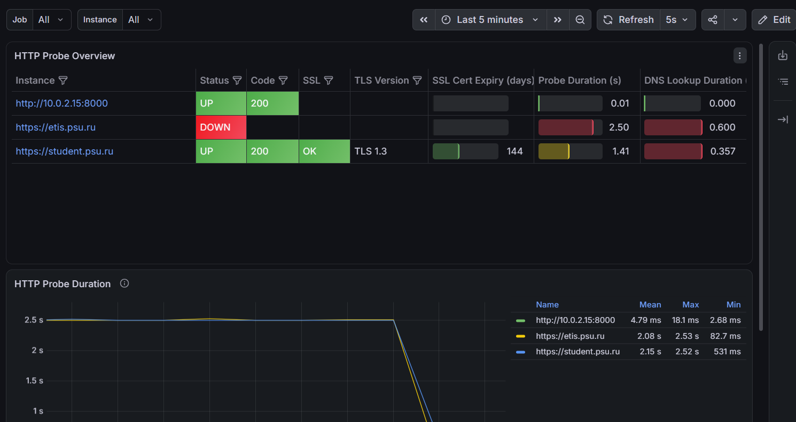

# Практическая работа №8: Docker Compose и стек мониторинга (Prometheus, Grafana)

## Выполнил: [Абубакиров Артур]

### Цель работы
1. Освоение инструмента оркестрации многоконтейнерных приложений **Docker Compose v2**.
2. Создание многоконтейнерного веб-приложения (`Flask + Redis`) со счетчиком посещений и межконтейнерной коммуникацией по внутреннему DNS Docker.
3. Развертывание стека мониторинга (`Prometheus + Grafana + Blackbox Exporter`) для сбора метрик и визуализации доступности сервисов.

---

### Шаг 1. Развертывание многоконтейнерного приложения Flask + Redis
- Установлен плагин оркестрации `docker-compose-v2`.
- В директории `flask_redis/` разработано веб-приложение на Python/Flask (`app.py`), использующее базу данных Redis (`host='redis'`, порт `6379`) для подсчета и сохранения количества посещений.
- Создан `dockerfile` на базе официального образа `python:3.10-slim` с установкой зависимостей из `requirements.txt` (`flask`, `redis`).
- В файле `compose.yaml` описаны два связанных сервиса: `web` (проброс порта `8000:5000`) и `redis` (`redis:alpine`).
- Стек запущен через Docker Compose; работоспособность счетчика проверена командами `curl 127.0.0.1:8000` и в браузере хостовой системы после настройки проброса порта `8000` в VirtualBox.

---

### Шаг 2. Развертывание стека мониторинга (Prometheus + Grafana)
- В директории `monitoring/` сформирована конфигурация для развертывания системы мониторинга.
- Настроен конфигурационный файл `prometheus/prometheus.yml` для сбора собственных метрик сервера Prometheus (`localhost:9090/metrics`).
- Настроен файл автоконфигурации `grafana/datasource.yml`, автоматически подключающий Prometheus (`http://prometheus:9090`) при старте Grafana.
- В `compose.yaml` описаны сервисы `prometheus` (порт `9090`), `grafana` (порт `3000`) и постоянные тома `prom_data`, `grafana_data`.
- Настроен проброс порта `3000` в VirtualBox; в веб-интерфейсе Grafana выполнена проверка поступления метрик (`prometheus_http_requests_total`) через раздел *Explore*.

---

### Шаг 3. Мониторинг веб-сервисов через Blackbox Exporter
- В `monitoring/compose.yaml` добавлен сервис `blackbox` на базе образа `prom/blackbox-exporter` (порт `9115`).
- В `prometheus/prometheus.yml` добавлена задача `blackbox-http` для периодического опроса веб-ресурсов по протоколу HTTP(S): развернутого приложения Flask (`http://10.0.2.15:8000`) и внешних порталов (`https://etis.psu.ru`, `https://student.psu.ru`).
- Стек мониторинга перезапущен (`docker compose down && docker compose up -d`), работоспособность экспортера проверена через `curl 127.0.0.1:9115`.
- В веб-интерфейс Grafana импортирован готовый дашборд **13659** (*Blackbox Exporter HTTP prober*), визуализирующий доступность сайтов, коды ответов, параметры TLS и графики задержек.

